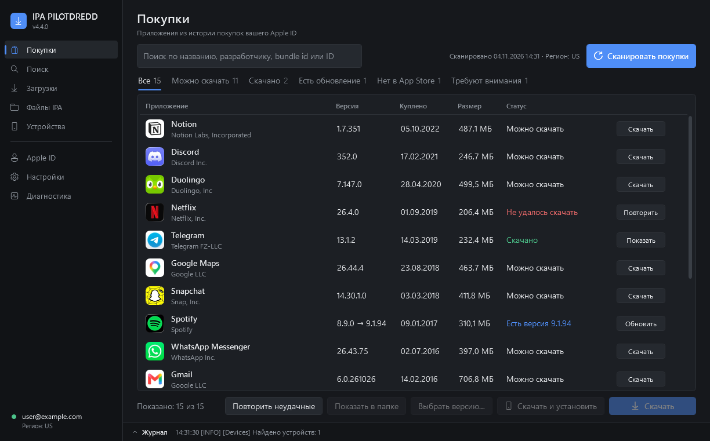
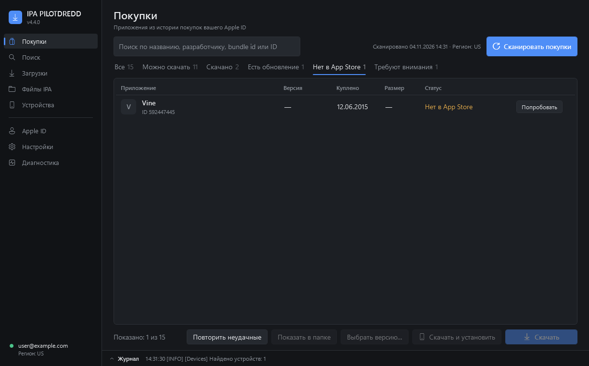
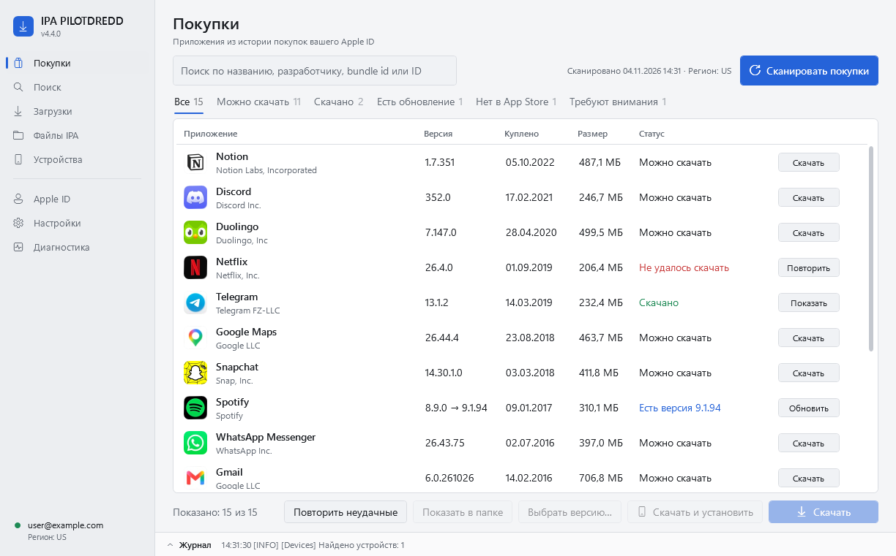
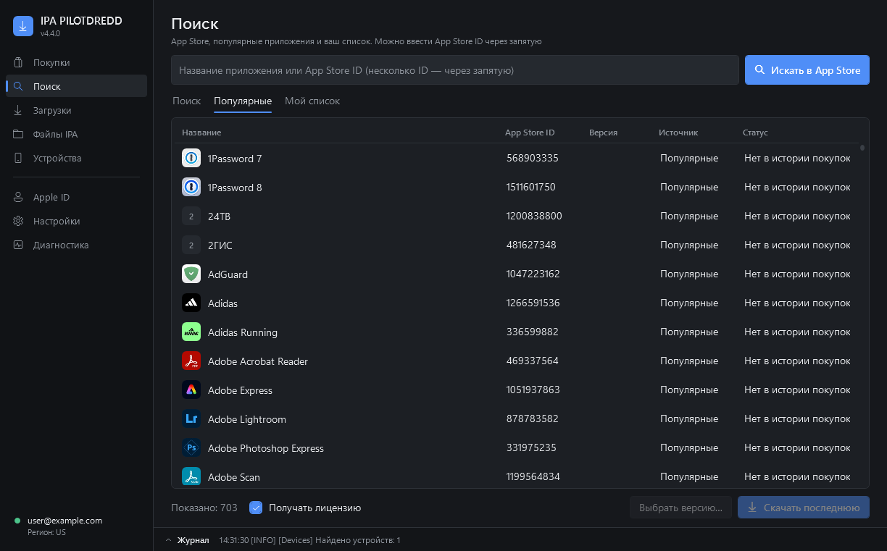
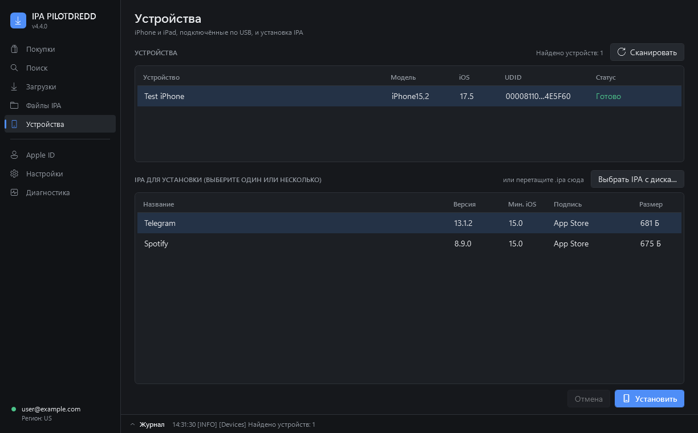

# IPA PILOTDREDD

**Библиотека ваших покупок App Store на Windows.** Войдите в свой Apple ID, нажмите «Сканировать покупки» — и увидите все приложения, которые вы когда-либо покупали или скачивали бесплатно: с иконками, версиями и понятным статусом. Скачать IPA и поставить на iPhone — в пару кликов.



> Работает только с покупками **вашего** Apple ID. Ничего не взламывает, не обходит защиту Apple и не раздаёт чужие приложения.

## Возможности

- **Библиотека покупок** — вся история покупок Apple ID с 2008 года: иконки, разработчик, версия в App Store, размер, дата покупки.
- **Честные статусы** — «Можно скачать», «Скачано», «Есть новая версия», «Нет в App Store», «Не удалось скачать» (только после реальной попытки, с текстом ответа Apple), «Не проверено». Никаких выдуманных «не куплено».
- **Приложения, снятые с продажи** — отдельная вкладка. Apple часто продолжает отдавать купленное даже после удаления из магазина — кнопка «Попробовать».
- **Скачать и установить** — одна кнопка: скачивает IPA и ставит на подключённый iPhone/iPad, с проверкой версии iOS и подписи.
- **Очередь загрузок** — сколько угодно приложений подряд, прогресс в строке, повтор неудачных; незавершённое продолжается после перезапуска.
- **Выбор версии** — скачать любую доступную старую версию приложения.
- **Поиск** — App Store, список популярных приложений и ваш собственный список; App Store ID через запятую.
- **Файлы IPA** — локальная коллекция: версия, минимальная iOS, тип подписи, установка на устройство.
- **Несколько Apple ID** — вход с 2FA, переключение между аккаунтами.
- **Автопроверка обновлений** — при запуске: «Всё готово к работе» или «Доступно обновление ipatool» с установкой в один клик.
- Тёмная и светлая темы, русский и английский, горячие клавиши.

| | |
|---|---|
|  |  |
|  |  |

## Чем отличается от IPA Downloader

IPA PILOTDREDD основан на консольном [IPA Downloader](https://github.com/kda2495/IPA_Downloader) (kda2495) и использует тот же ipatool-cpp. Спасибо автору!

| | IPA Downloader | IPA PILOTDREDD |
|---|---|---|
| Интерфейс | консоль, меню с номерами команд | окно Windows: таблицы, поиск, фильтры, кнопки |
| История покупок | текстовый список | библиотека с иконками, версиями, размерами и статусами |
| Снятые с продажи | в общем списке | отдельная вкладка и понятный статус |
| Загрузки | по одной команде | очередь, прогресс, повтор, продолжение после перезапуска |
| Установка на iPhone | отдельная команда для папки Apps | «Скачать и установить» из любой строки, проверка iOS и подписи |
| Обновление ipatool | вручную, новым архивом | проверка при запуске, установка в один клик с проверкой SHA-256 |
| Журналы | вывод в консоли | журнал с маскировкой email, паролей, кодов 2FA и DSID |
| Платформы | Windows, macOS, Linux | Windows 10/11 |

## Установка

1. Скачайте `IPA_PILOTDREDD_<версия>_portable.zip` со страницы [Releases](../../releases).
2. Распакуйте **целиком** в любую папку (можно на флешку) и запустите `IPA_PILOTDREDD.exe`.
3. При первом запуске нажмите **«Загрузить компоненты»** — программа скачает ipatool и инструменты для iPhone из официального релиза IPA Downloader (~100 МБ, один раз) и проверит контрольную сумму.
4. Войдите в Apple ID (внизу боковой панели) → **Покупки** → **Сканировать покупки**.

Программа portable: ничего не устанавливает, все данные (скачанные IPA, настройки, журналы) хранятся в её папке.

**Требования:** Windows 10/11 (встроенный PowerShell 5.1, ничего ставить не нужно). Для установки на iPhone — драйвер Apple: приложение «Apple Devices» из Microsoft Store или iTunes.

**«Система Windows защитила ваш компьютер»** — у программы нет платной цифровой подписи. Нажмите «Подробнее» → «Выполнить в любом случае». Если exe не запускается, используйте `Start_IPA_Dredd_Windows.bat`.

## Безопасность

- Пароль Apple ID нигде не сохраняется. Сессия хранится там же, где у ipatool (`%USERPROFILE%\.ipatool`). Для общих компьютеров есть вход через консоль — пароль не попадает в аргументы процессов.
- В журналах маскируются email, пароли, коды 2FA, cookie и DSID аккаунта.
- Программа обращается только к серверам Apple, публичному iTunes Lookup (иконки и версии) и GitHub (компоненты). Телеметрии нет.
- Не публикуйте свои IPA: внутри файла записан Apple ID покупателя.

Подробнее — [docs/SECURITY.md](docs/SECURITY.md).

## Горячие клавиши

`Ctrl+F` — поиск · `F5` — сканировать/обновить · `Enter` — скачать выбранное · `Ctrl+C` — копировать ID · `Ctrl+L` — журнал · `Ctrl+1…5` — разделы

## Для разработчиков

PowerShell 5.1 + WPF, без сборки. Логика — модуль `src/Core` (без UI), интерфейс — `src/GUI`.

```powershell
powershell -NoProfile -ExecutionPolicy Bypass -File tests\Run-Tests.ps1         # тесты ядра
powershell -NoProfile -ExecutionPolicy Bypass -File tools\Run-GuiSelfTest.ps1   # самопроверка интерфейса со сценарием
powershell -NoProfile -ExecutionPolicy Bypass -File tools\Build-Release.ps1     # portable-архив в dist\
```

Номер версии — файл `VERSION`. Архитектура и решения — [docs/ARCHITECTURE.md](docs/ARCHITECTURE.md), [docs/DECISIONS.md](docs/DECISIONS.md), тесты — [docs/TESTING.md](docs/TESTING.md), история изменений — [CHANGELOG.md](CHANGELOG.md).

## Благодарности

- [kda2495 / IPA Downloader](https://github.com/kda2495/IPA_Downloader) — основа проекта и список приложений.
- [ipatool-cpp](https://github.com/Sorvigolova/ipatool) и [majd/ipatool](https://github.com/majd/ipatool).
- [libimobiledevice](https://libimobiledevice.org/).

Если программа пригодилась — [поддержать PILOTDREDD](https://pay.cloudtips.ru/p/129557e1) ☕

## Лицензия

MIT — см. [LICENSE](LICENSE) и [THIRD_PARTY_NOTICES.md](THIRD_PARTY_NOTICES.md). Используйте только с собственными покупками; соблюдение условий Apple и законов вашей страны остаётся за вами.

---

**English.** IPA PILOTDREDD is a Windows app that turns your own Apple ID purchase history into a browsable library with icons and honest statuses, downloads IPAs (any available version) and installs them on a connected iPhone/iPad. Based on [IPA Downloader](https://github.com/kda2495/IPA_Downloader); uses ipatool-cpp and libimobiledevice, which the app downloads on first run from the official IPA Downloader release. Windows 10/11, portable. MIT license.
