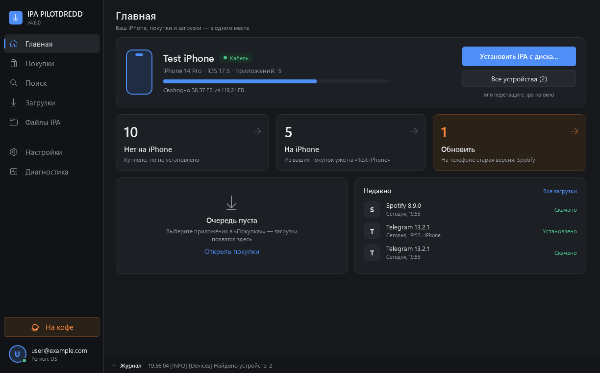
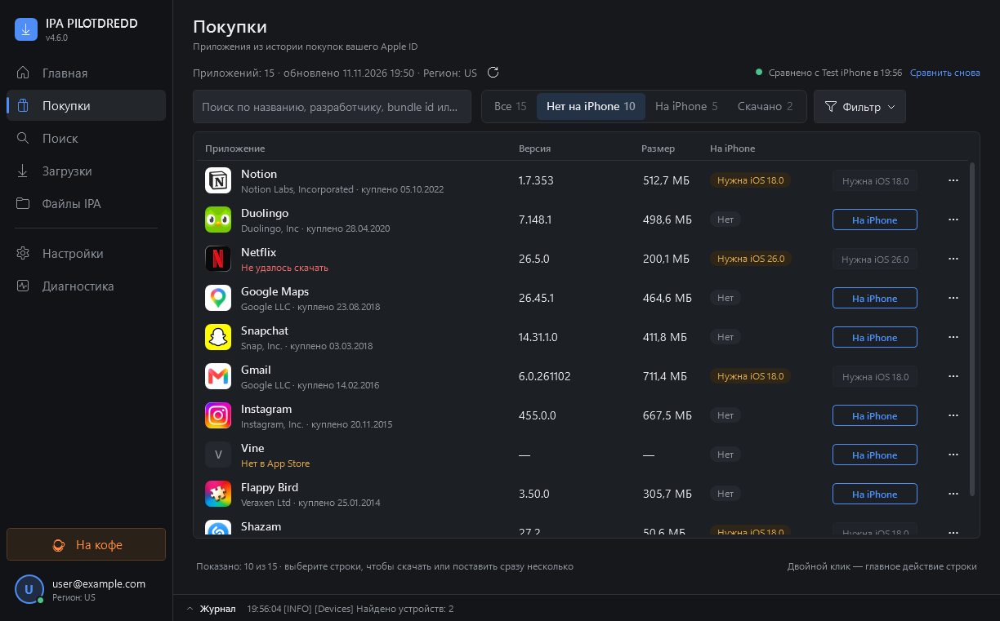
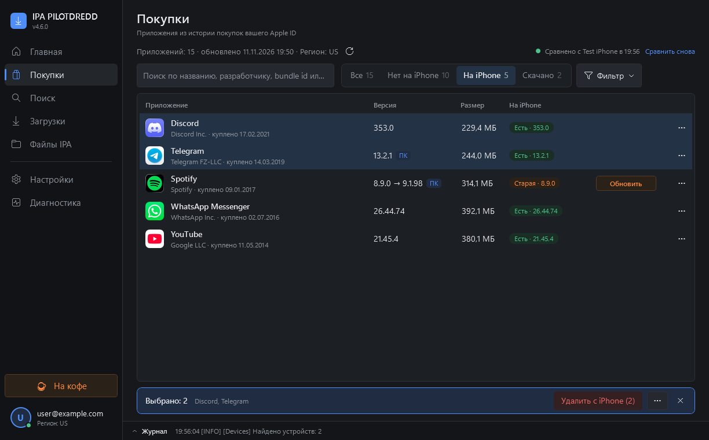
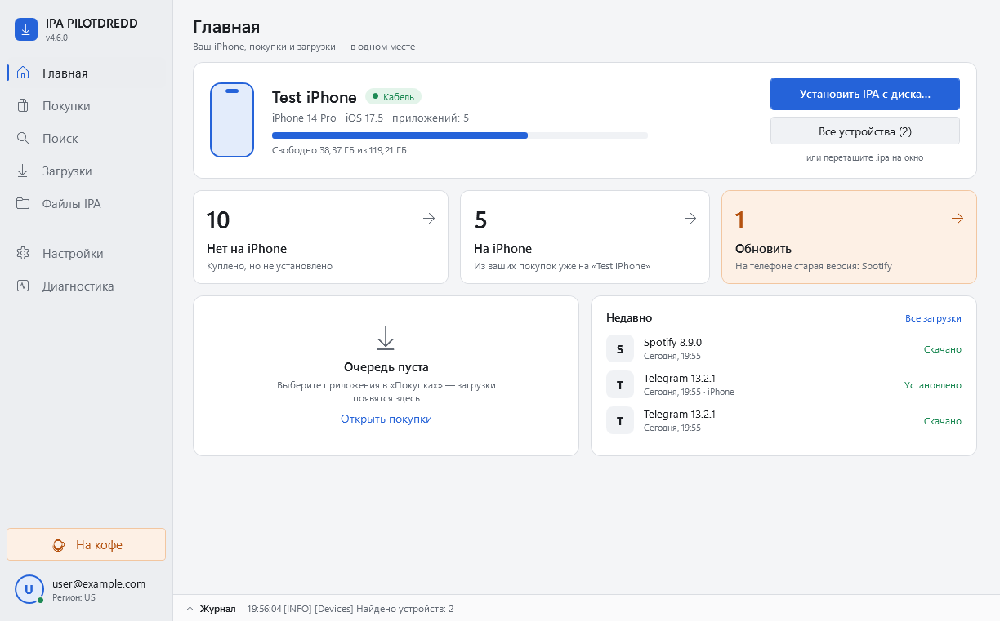

# IPA PILOTDREDD

**Библиотека ваших покупок App Store на Windows.** Войдите в свой Apple ID — и увидите все приложения, которые вы когда-либо покупали или скачивали бесплатно: с иконками и версиями. Подключите iPhone — программа сама покажет, чего на нём нет и что пора обновить. Поставить — одной кнопкой.




> Работает только с покупками **вашего** Apple ID. Ничего не взламывает, не обходит защиту Apple и не раздаёт чужие приложения.

## Возможности

- **Главная** — карточка iPhone (модель, iOS, кабель или Wi-Fi, свободное место) и три плитки: «Нет на iPhone», «На iPhone», «Обновить». Установка IPA с диска — кнопкой или перетаскиванием файла.
- **Библиотека покупок** — вся история покупок Apple ID с 2008 года: иконки, разработчик, версия в App Store, размер, дата покупки. Четыре вкладки — «Все / Нет на iPhone / На iPhone / Скачано» — и «Фильтр» для редкого.
- **Сравнение с iPhone само** — подключили телефон, и у каждой покупки видно: нет на iPhone, стоит, стоит старая версия или нужна iOS новее.
- **Одна кнопка в строке** — «На iPhone» (скачать и поставить), «Обновить» или «Нужна iOS N». Выбрали несколько — поставить, обновить или удалить с iPhone разом.
- **Честные статусы** — «Нет в App Store», «Не удалось скачать» (только после реальной попытки, с текстом ответа Apple), «Не проверено». Никаких выдуманных «не куплено».
- **Приложения, снятые с продажи** — в фильтре «Нет в App Store». Apple часто продолжает отдавать купленное даже после удаления из магазина.
- **По кабелю и по Wi-Fi** — iPhone/iPad находится и по сети, если в «Apple Devices»/iTunes включена синхронизация по Wi-Fi.
- **Очередь загрузок** — сколько угодно приложений подряд, прогресс в строке, повтор неудачных; незавершённое продолжается после перезапуска.
- **Выбор версии** — скачать любую доступную старую версию приложения.
- **Поиск** — App Store, список популярных приложений и ваш собственный список; App Store ID через запятую.
- **Файлы IPA** — локальная коллекция: версия, минимальная iOS, тип подписи, установка на устройство.
- **Несколько Apple ID** — вход с 2FA, переключение между аккаунтами.
- **Автопроверка обновлений** — при запуске: «Вышла новая IPA PILOTDREDD», «Доступно обновление ipatool» (установка в один клик) или «Всё готово к работе».
- Тёмная и светлая темы, русский и английский, горячие клавиши.

| | |
|---|---|
|  |  |
|  |  |

## Чем отличается от IPA Downloader

IPA PILOTDREDD основан на консольном [IPA Downloader](https://github.com/kda2495/IPA_Downloader) (kda2495) и использует тот же ipatool-cpp. Спасибо автору!

| | IPA Downloader | IPA PILOTDREDD |
|---|---|---|
| Интерфейс | консоль, меню с номерами команд | окно Windows: таблицы, поиск, фильтры, кнопки |
| История покупок | текстовый список | библиотека с иконками, версиями, размерами и статусами |
| Снятые с продажи | в общем списке | отдельная вкладка и понятный статус |
| Загрузки | по одной команде | очередь, прогресс, повтор, продолжение после перезапуска |
| Установка на iPhone | отдельная команда для папки Apps | «Скачать и установить» из любой строки, проверка iOS и подписи, по кабелю или Wi-Fi |
| Что стоит на iPhone | — | сравнение с покупками: чего нет на телефоне, что устарело |
| Обновление ipatool | вручную, новым архивом | проверка при запуске, установка в один клик с проверкой SHA-256 |
| Журналы | вывод в консоли | журнал с маскировкой email, паролей, кодов 2FA и DSID |
| Платформы | Windows, macOS, Linux | Windows 10/11 |

## Установка

1. Скачайте `IPA_PILOTDREDD_<версия>_portable.zip` со страницы [Releases](../../releases).
2. Распакуйте **целиком** в любую папку (можно на флешку) и запустите `IPA_PILOTDREDD.exe`.
3. При первом запуске нажмите **«Загрузить компоненты»** — программа скачает инструменты для iPhone из официального релиза IPA Downloader (~100 МБ, один раз) и свежий ipatool-cpp из его официального релиза, проверив контрольные суммы. Дальше обновления ipatool приходят напрямую от ipatool-cpp.
4. Войдите в Apple ID (внизу боковой панели) → **Покупки** — список загрузится сам (обновить — кнопкой ↻). Подключите iPhone кабелем или по Wi-Fi.

Программа portable: ничего не устанавливает, все данные (скачанные IPA, настройки, журналы) хранятся в её папке.

**Требования:** Windows 10/11 (встроенный PowerShell 5.1, ничего ставить не нужно). Для установки на iPhone — драйвер Apple: приложение «Apple Devices» из Microsoft Store или iTunes. Для Wi-Fi — один раз подключить телефон кабелем и включить в «Apple Devices»/iTunes «Показывать этот iPhone при подключении к Wi-Fi».

**«Система Windows защитила ваш компьютер»** — у программы нет платной цифровой подписи. Нажмите «Подробнее» → «Выполнить в любом случае».

**Антивирус пишет «вирус или нежелательная программа»** — это ложное срабатывание: `IPA_PILOTDREDD.exe` — маленький запускатор с открытым исходником ([tools/Launcher/Launcher.cs](tools/Launcher/Launcher.cs)), который выполняет `IPA_Dredd.ps1` встроенным в Windows PowerShell. С 4.5.1 релизы собираются на серверах GitHub из этого репозитория, а у архива есть подпись происхождения — проверить: `gh attestation verify IPA_PILOTDREDD_<версия>_portable.zip -R PiloTDredd/IPA_PILOTDREDD`. Если exe заблокирован, запускайте `Start_IPA_Dredd_Windows.bat` и пришлите название угрозы из «Безопасность Windows» → «Журнал защиты» в [Issues](../../issues).

## Безопасность

- Пароль Apple ID нигде не сохраняется. Сессия хранится там же, где у ipatool (`%USERPROFILE%\.ipatool`). Для общих компьютеров есть вход через консоль — пароль не попадает в аргументы процессов.
- В журналах маскируются email, пароли, коды 2FA, cookie и DSID аккаунта.
- Программа обращается только к серверам Apple, публичному iTunes Lookup (иконки и версии) и GitHub (компоненты, проверка новых версий). Телеметрии нет. Список приложений с iPhone читается локально и никуда не отправляется и не сохраняется.
- Не публикуйте свои IPA: внутри файла записан Apple ID покупателя.

Подробнее — [docs/SECURITY.md](docs/SECURITY.md).

## Горячие клавиши

`Ctrl+F` — поиск · `F5` — сканировать/обновить · `Enter` — скачать выбранное · `Ctrl+C` — копировать ID · `Ctrl+L` — журнал · `Ctrl+1…5` — разделы (Главная, Покупки, Поиск, Загрузки, Файлы IPA)

## Для разработчиков

PowerShell 5.1 + WPF, без сборки. Логика — модуль `src/Core` (без UI), интерфейс — `src/GUI`.

```powershell
powershell -NoProfile -ExecutionPolicy Bypass -File tests\Run-Tests.ps1         # тесты ядра
powershell -NoProfile -ExecutionPolicy Bypass -File tools\Run-GuiSelfTest.ps1   # самопроверка интерфейса со сценарием
powershell -NoProfile -ExecutionPolicy Bypass -File tools\Build-Release.ps1     # portable-архив в dist\
```

Номер версии — файл `VERSION`. Архитектура и решения — [docs/ARCHITECTURE.md](docs/ARCHITECTURE.md), [docs/DECISIONS.md](docs/DECISIONS.md), тесты — [docs/TESTING.md](docs/TESTING.md), история изменений — [CHANGELOG.md](CHANGELOG.md).

## Благодарности

- [kda2495 / IPA Downloader](https://github.com/kda2495/IPA_Downloader) — основа проекта и список приложений.
- [ipatool-cpp](https://github.com/Sorvigolova/ipatool) и [majd/ipatool](https://github.com/majd/ipatool).
- [libimobiledevice](https://libimobiledevice.org/).

Если программа пригодилась — [поддержать PILOTDREDD](https://pay.cloudtips.ru/p/129557e1) ☕

## Лицензия

MIT — см. [LICENSE](LICENSE) и [THIRD_PARTY_NOTICES.md](THIRD_PARTY_NOTICES.md). Используйте только с собственными покупками; соблюдение условий Apple и законов вашей страны остаётся за вами.

---

**English.** IPA PILOTDREDD is a Windows app that turns your own Apple ID purchase history into a browsable library with icons and honest statuses, downloads IPAs (any available version), installs them on an iPhone/iPad connected by cable or Wi-Fi and shows which purchases are missing on the phone. Based on [IPA Downloader](https://github.com/kda2495/IPA_Downloader); uses ipatool-cpp and libimobiledevice, which the app downloads on first run from the official IPA Downloader release. Windows 10/11, portable. MIT license.
