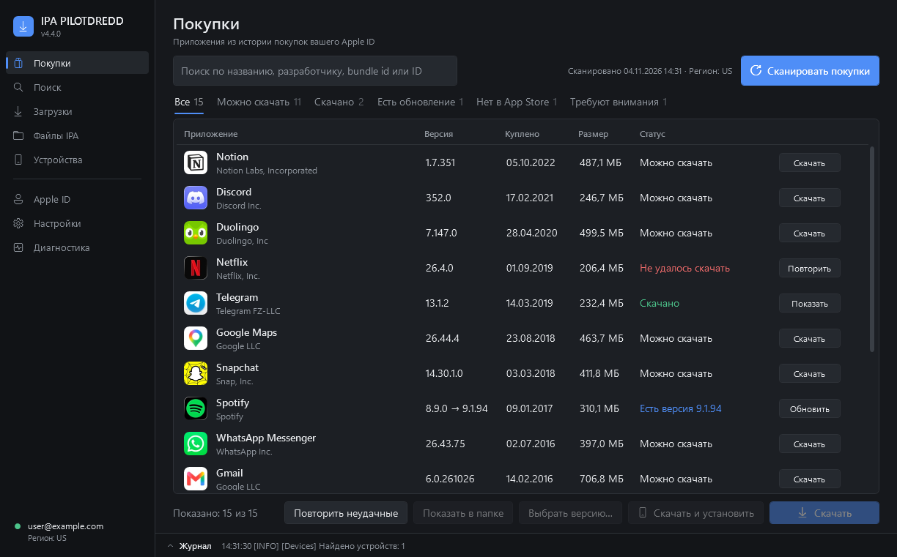

Первый публичный релиз **IPA PILOTDREDD** — Windows-программы для работы с покупками App Store вашего Apple ID.

### Главное
- **Библиотека покупок**: вся история покупок Apple ID с иконками, версиями, размерами и честными статусами («Можно скачать», «Скачано», «Есть новая версия», «Нет в App Store», «Не удалось скачать»).
- **Снятые с продажи приложения** — отдельная вкладка и кнопка «Попробовать».
- **Скачать и установить** на подключённый iPhone/iPad одной кнопкой, с проверкой iOS и подписи.
- **Очередь загрузок** с прогрессом, повтором и продолжением после перезапуска.
- **Автопроверка обновлений ipatool** при запуске, установка в один клик с проверкой SHA-256.
- Поиск по App Store и спискам, выбор старой версии, несколько Apple ID, тёмная/светлая тема, RU/EN.

### Установка
1. Скачайте `IPA_PILOTDREDD_4.4.0_portable.zip` ниже и распакуйте целиком в любую папку.
2. Запустите `IPA_PILOTDREDD.exe` (если Windows покажет предупреждение SmartScreen — «Подробнее» → «Выполнить в любом случае»).
3. Нажмите «Загрузить компоненты»: ipatool и инструменты для iPhone скачаются из официального релиза [IPA Downloader](https://github.com/kda2495/IPA_Downloader) (~100 МБ, один раз).
4. Войдите в Apple ID → «Покупки» → «Сканировать покупки».

Требования: Windows 10/11. Для установки на iPhone — «Apple Devices» из Microsoft Store или iTunes.

Основано на [IPA Downloader](https://github.com/kda2495/IPA_Downloader) (kda2495) — спасибо автору. Используйте только с собственными покупками.
