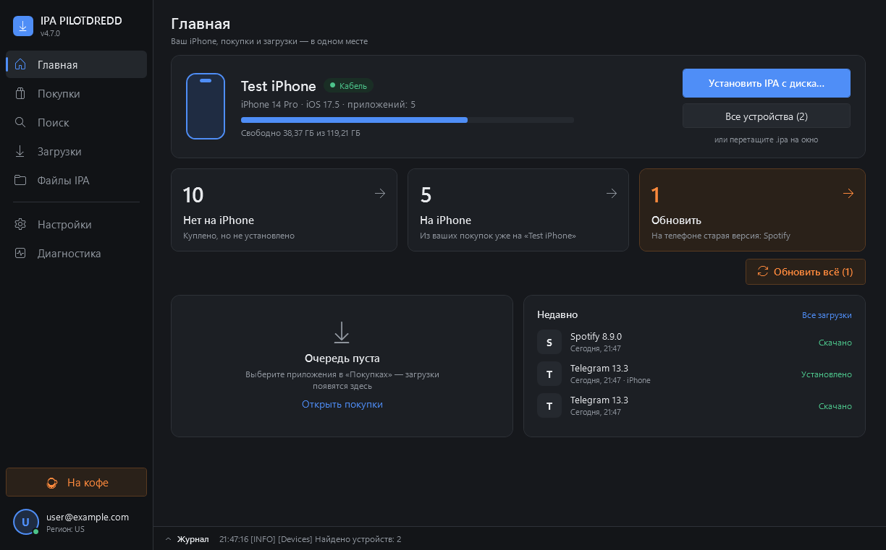
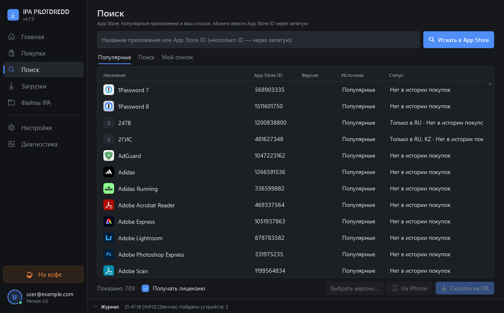

Одна кнопка — и все приложения на iPhone свежие. Плюс честные метки в «Популярных»: сразу видно, что из списка удалено из App Store.





### Новое
- **«Обновить всё (N)»** — на «Главной» и в «Покупках». Подключили iPhone — программа сравнила его с покупками и одной кнопкой скачивает и ставит свежие версии всего, что устарело.
- **Отчёт после пакетной установки.** Поставили или обновили несколько приложений — в конце итог: «Обновлено 12 из 14 на "iPhone"», что не встало и почему (одинаковые причины вместе), что пропущено (уже стоит, не подходит к iOS). Кнопки «Скопировать отчёт» и «Повторить неудачные».
- **Светофор в «Популярных».** У каждого приложения из списка видно: «Удалено из App Store» или «Только в US, KZ», если в вашем регионе его нет. Больше половины старого списка уже удалено из App Store — теперь это видно до попытки скачать. Проверка идёт каждую ночь на GitHub по регионам RU, US и KZ; программа берёт готовый результат при запуске.

### Прозрачность
Релиз собран на серверах GitHub из кода этого репозитория. Проверить, что архив не подменён:
```
gh attestation verify IPA_PILOTDREDD_4.7.0_portable.zip -R PiloTDredd/IPA_PILOTDREDD
```

### Как обновиться
Скачайте `IPA_PILOTDREDD_4.7.0_portable.zip`, откройте его и **скопируйте содержимое папки `IPA_PILOTDREDD_4.7.0` поверх своей папки с программой** (с заменой файлов). Скачанные IPA, настройки, история, аккаунты и компоненты сохранятся.
